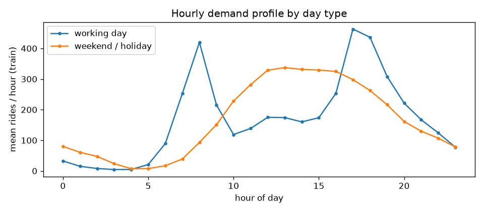
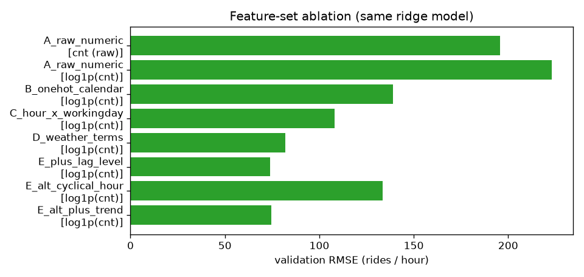
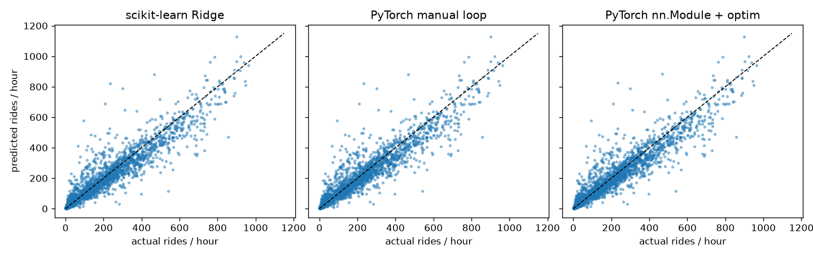
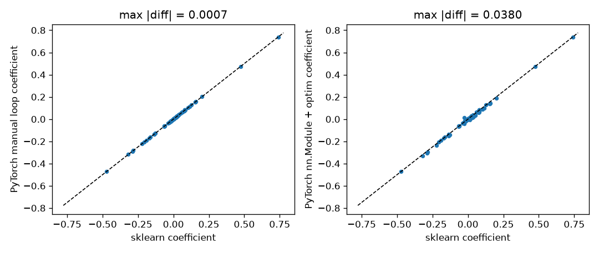
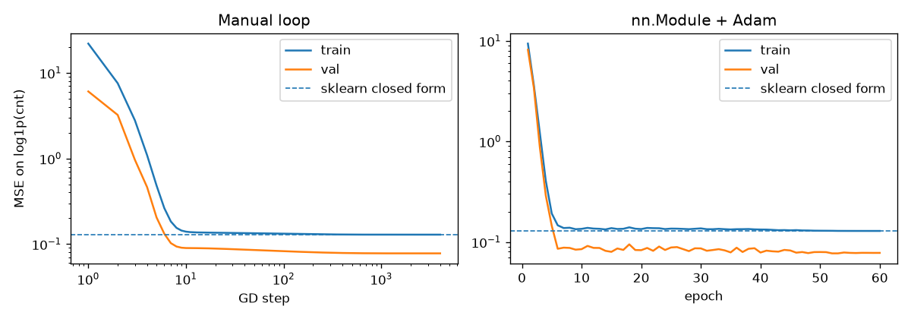
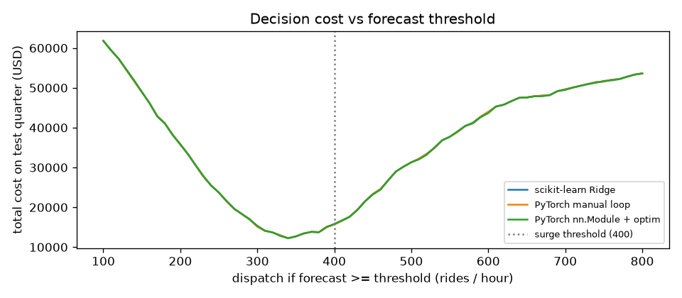
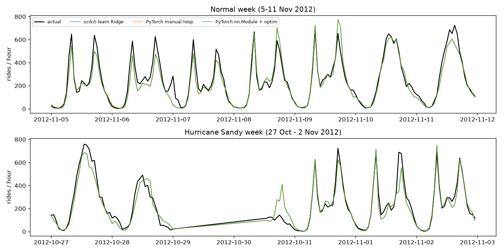

# Assignment 1 Report

- **Name**: Mariano Delpree
- **Student ID**:19970
- **Email**: mdelpree.ieu2022@student.ie.edu
- **Group**: BBADBA 5B

## Dataset

**UCI Bike Sharing Dataset, hourly file** (`data/hour.csv`, UCI id 275,
Fanaee-T & Gama 2013). 

It is the Capital Bikeshare (Washington DC) trip log
for 2011-2012 aggregated per hour by the dataset authors and joined with
weather and calendar information. One row is one hour of the system:
calendar fields (`yr`, `mnth`, `hr`, `weekday`, `holiday`, `workingday`,
`season`), weather (`weathersit` category, `temp`, `atemp`, `hum`,
`windspeed`), and the ride counts (`casual`, `registered`, `cnt`).

I picked it because a *linear* model is almost useless on the raw columns
(validation R² of 0.28) and becomes genuinely useful only through feature
engineering (R² of 0.90). Demand has a bimodal daily shape that flips on
weekends, a strong year-on-year growth trend, non-linear weather effects, and
a real time axis, so the questions of target definition, split strategy and
leakage all have teeth. It is also small enough to retrain from scratch in
CI in a few minutes.

Things found during exploration that shaped the pipeline:

- Only 17,379 of the 17,544 possible hours exist: hours with zero rides are
  simply absent. Most of the 165 missing hours are 2-5  since this is when the system is not functioning, but whole blocks
  are missing on storm days as well. These are system shutdowns, not demand, so I did
  not reinsert them as zeros.
- `cnt` is right-skewed (median 142, max 977) and `log1p(cnt)` is close to
  symmetric shaped as a bell so i chose to use it instead. There are no zeros.
- The whole of 2011-03-10 has `hum = 0` being probably a sensor defect (0 % humidity is not
  physically plausible in DC). `atemp` is 0.988-correlated with `temp` and
  is constant for all of 2012-08-17 (another known defect). 12.5 % of rows
  have `windspeed = 0`, far more than a real anemometer would give.
- Mean rides per hour grew 1.74x from H1 2011 to H1 2012 but only 1.54x
  from Q4 2011 to Q4 2012: the growth was decelerating.
- `weathersit = 4` (heavy rain / ice) occurs 3 times in 17k rows so it probably wont add any value.

## Business / real-life framing

**Scenario.** The Capital Bikeshare operations team has to decide every
evening how to staff the next day's *rebalancing crews* (vans that move
bikes from full stations to empty ones). In a surge hour, commuter stations
run dry and rides are lost; sending a crew in a quiet hour wastes a van and
two people. The model is a **day-ahead hourly demand forecast** for the
whole system, produced the evening before from the calendar, the weather
forecast and recent demand. I defined the decision as: *dispatch an extra
crew in hour h if the forecast for h is at least a threshold t*. A surge
hour is one with at least 400 actual rides (roughly the 90th percentile of
training-period demand). I assumed a missed surge costs 150 USD (lost rides
and goodwill) and an unneeded crew 60 USD (van plus two staff-hours). The
numbers are assumptions, but their *ratio* is what matters: a miss is
about 2.5x worse than a false alarm.

**What this changed in the pipeline:**

1. **Target definition.** The model predicts using `log1p(cnt)` instead of just `cnt` and I report
   errors in rides after `expm1`. Demand drivers act multiplicatively (rain
   removes a % of rides not a fixed number of them and the 2012
   growth multiplies every hour's level) so an additive linear model on
   the raw count has structurally wrong errors. The ablation below shows
   this is only true once the hour encoding is corrected because before on the raw features,
   the log target is actually worse.
2. **Time-based split.** Data from Jan 2011 - Jun 2012, validate Jul - Sep
   2012 (2,208), test is from Oct - Dec 2012 (2,168). A random split would put
   hours from the same day and from the future into training because
   consecutive hours are highly autocorrelated and 2012 is systematically
   higher than 2011, a random split would report a score the operator
   would never see in production. The test quarter is the next
   quarter after the model was built. It also contains Hurricane Sandy,
   which is what real deployments look like.
3. **Leakage-safe lag feature.** The forecast for day *d* is produced on
   the evening of *d-1*, when day *d-1* is not finished. So the recent
   demand feature only uses days *d-2 .. d-8* (7-day mean of the same hour's
   `log1p(cnt)`, requiring at least 3 observed values). Shifting by one day
   instead would use information the operator does not have yet.
4. **Metric for the decision threshold.** Model selection uses RMSE in
   rides (peak-hour misses are what cost money, and RMSE punishes them),
   while the dispatch threshold is set by **expected dispatch cost**
   (`missed surges x 150 + unneeded crews x 60`) on the validation quarter,
   not by accuracy. Because a miss is more expensive than a false alarm,
   the cost-optimal threshold ends up *below* the surge level (350 rides of
   forecast vs 400 rides of actual demand).

## Data preparation & feature engineering

All of this lives in `pipeline.py`; the preprocessor is fit on the training
window only and saved to `artifacts/preprocessor.joblib`, and the app
re-applies it unchanged.

**Cleaning decisions**

| problem | decision | why |
|---|---|---|
| `hum = 0` for all of 2011-03-10 | set to NaN, impute with the *training* median humidity of the same calendar month (a small sklearn-compatible transformer inside the saved pipeline) | 0 % RH is a defect; a month median is the least-wrong plausible value and never uses validation/test data |
| `atemp` | dropped; `temp` rescaled to degrees Celsius | 0.988 correlation with `temp` (two near-duplicate columns only make ridge/GD worse) and a known defect on 2012-08-17 |
| `weathersit = 4` (3 rows) | merged into category 3 | a one-hot column fit on three rows is noise |
| `windspeed = 0` in 12.5 % of rows | kept, plus a `windspeed_zero` flag | lets the model treat "0" as its own regime (calm or missing) instead of extrapolating the wind effect through it |
| missing hours | left absent; the lag window simply has fewer values | they are shutdowns, not zero demand |
| `casual`, `registered`, `instant` | not used | `casual + registered = cnt` (target leakage); `instant` is a row id |

**Engineered features (final set, 77 columns after encoding)**

- `hr x workingday` as 48 one-hot categories instead of 24 hour dummies.
  Working days have two commute peaks (8h: 477 rides, 17h: 525) and
  non-working days have one afternoon hump (13h: 373). A single hour effect
  would average the two shapes and get both wrong. This one change cut
  validation RMSE from 139 to 108.
- Month (12) and weekday (7) one-hot, `holiday`, `yr`. Month absorbs
  seasonality on top of temperature; `yr` is the 2011 -> 2012 level shift.
- Weather: `weathersit` one-hot (3 levels after the merge), `temp_c`,
  `temp_c²` (demand flattens above ~30 °C: 330 rides/h at 30-35 °C vs 318
  above 35 °C), `temp_c x hum` (humidity hurts more when it is hot),
  `windspeed`, `windspeed_zero`, and `badweather x nonworking` (rain removes
  leisure rides more than commutes).
- `lag_level`: 7-day mean of `log1p(cnt)` at the same hour, days *d-2..d-8*.
  This is the only feature that tracks the *level* of demand (growth, new
  stations, season) without extrapolating a trend.
- Encoding: `OneHotEncoder(drop="first")` so the dummies are not collinear
  with the intercept, then `StandardScaler` on **every** column including
  the dummies. Standardising matters twice: ridge penalises all
  coefficients equally, which only makes sense if columns share a scale,
  and gradient descent in the PyTorch versions converges far faster on a
  well-conditioned matrix.

**Ablation (same ridge model, alpha = 1, scored on the validation quarter
in rides/hour).** This is the evidence for the choices above.

| feature set | columns | val RMSE | val R² |
|---|---|---|---|
| A. raw numeric columns, raw `cnt` target | 10 | 195.7 | 0.283 |
| A. raw numeric columns, `log1p` target | 10 | 223.2 | 0.067 |
| B. + one-hot hour, weekday, month, weather | 48 | 139.1 | 0.638 |
| C. hour x workingday instead of hour | 72 | 108.2 | 0.781 |
| D. + temp², temp x hum, wind flag, bad-weather x non-working | 76 | 82.0 | 0.874 |
| **E. + lag_level (final)** | **77** | **74.0** | **0.897** |
| E-alt: cyclical hour (3 sin/cos harmonics) instead of the 48 dummies | 36 | 133.6 | 0.666 |
| E-alt: + linear time trend | 78 | 74.6 | 0.896 |

What did not work, and why:

- **The log target on its own hurts.** With raw numeric features, moving to
  `log1p` made validation RMSE *worse* (195.7 -> 223.2). A linear function
  of "hour as a number" cannot fit the daily shape, and exponentiating a
  badly fit log model amplifies the misses. The transform only pays off
  together with a hour encoding that can represent the shape (rows B-E).
- **Cyclical hour encoding** (sin/cos with 3 harmonics, the "elegant"
  option) was much worse than the 48 dummies (133.6 vs 74.0). Three
  harmonics cannot represent two sharp commute peaks plus a flat night,
  and more importantly the sin/cos terms are the same on weekdays and
  weekends, so they lose the interaction that matters most.
- **A linear time trend** did not help (74.6 vs 74.0). Growth was
  decelerating, so a straight line fit on Jan 2011 - Jun 2012 would
  over-extrapolate into the test quarter; `lag_level` captures the level
  without that risk. I left the trend out.
- **Ridge strength barely matters** once features are standardised:
  validation RMSE is 74.02 at alpha 0.01-0.1, 74.03 at 1, 74.07 at 3,
  74.20 at 10, 76.19 at 100. See the modeling section for why I did not
  simply take the smallest value.

## Modeling: three implementations, one model

**Model.** Ridge-regularised **linear regression** (continuous target). All
three implementations minimise the identical objective on the identical
standardised matrix and the identical `log1p` target:

    scikit-learn Ridge:   Σ (y - Xw - b)²  +  α ||w||²
    divided by n:         MSE(y, Xw + b)   +  (α / n) ||w||²

- **scikit-learn** `Ridge(alpha=α)` solves it in closed form.
- **Manual PyTorch loop**: `w` and `b` are plain tensors with
  `requires_grad=True`, the loss is literally `mse + (α/n) * (w**2).sum()`,
  `loss.backward()` fills the gradients, and the update is a hand-written
  `w -= lr * w.grad` inside `torch.no_grad()`, followed by zeroing the
  gradients. Full-batch gradient descent, 4,000 steps, started from zero
  (the problem is convex, so the start does not matter).
- **Standard PyTorch**: `nn.Linear(77, 1)` inside an `nn.Module`,
  `nn.MSELoss`, `torch.optim.Adam` with mini-batches of 256 from a
  `DataLoader`, 60 epochs with a cosine learning-rate schedule so the
  mini-batch noise settles. The ridge penalty goes through the optimiser's
  `weight_decay`. PyTorch's weight decay adds `wd * w` to the gradient,
  which corresponds to a penalty of `(wd/2) ||w||²`, so matching sklearn
  requires **`wd = 2α / n`**, applied to the weight only (sklearn never
  penalises the intercept, so the bias gets `weight_decay = 0`).

**Tuning (validation quarter only).** Alpha from {0.01, 0.1, 1, 3, 10, 30,
100}; learning rate from {0.03, 0.1, 0.2, 0.3} for the manual loop and
{0.001, 0.003, 0.01, 0.03} for Adam. Nothing else was tuned. For alpha, the
validation curve is flat below 3 and at the smallest values scikit-learn
warns that the matrix is ill-conditioned (`temp_c`, `temp_c²` and
`temp_c x hum` are nearly collinear). I therefore take the **largest alpha
within 0.1 % of the best validation RMSE**, which gives alpha = 3: same
accuracy, a better-posed problem, and all three implementations land on
the same coefficients, not just the same predictions.

**Results on the held-out test quarter (Oct - Dec 2012, 2,168 hours), in
rides per hour.** Bias is mean(prediction - actual); peak MAE is the MAE on
hours with at least 400 actual rides.

| model | MAE | RMSE | R² | RMSLE | bias | peak-hour MAE |
|---|---|---|---|---|---|---|
| Baseline: training mean | 171.4 | 241.5 | -0.435 | 1.440 | -133.0 | 486.9 |
| Baseline: hour x day-type profile | 99.8 | 143.6 | 0.492 | 0.657 | -73.8 | 266.6 |
| Baseline: last week's same-hour level (`lag_level` alone) | 83.1 | 123.6 | 0.624 | 0.695 | -11.2 | 182.6 |
| **scikit-learn Ridge** (alpha = 3) | **44.6** | **73.0** | **0.869** | **0.429** | -6.6 | 82.1 |
| **PyTorch manual loop** (lr = 0.2, 4,000 full-batch steps) | **44.6** | **73.0** | **0.869** | **0.429** | -6.6 | 82.1 |
| **PyTorch nn.Module + Adam** (lr = 0.03, 60 epochs, wd = 2α/n = 4.6e-4) | **44.5** | **72.9** | **0.869** | **0.429** | -6.5 | 81.9 |

Validation-quarter RMSE for the three is 74.07 / 74.07 / 74.11. Learning
rates: for the manual loop 0.03 had not fully converged after 4,000 steps
(74.41), 0.1 and 0.2 were equal (74.07), and 0.3 diverged to infinity,
which is the expected behaviour of plain gradient descent once the step
exceeds 2 / L for the largest curvature of the loss. For Adam, 0.001 and
0.003 were nowhere near converged after 60 epochs (351 and 227), 0.01 was
close (75.5) and 0.03 matched the closed form (74.1).

**Do the three agree?** Yes, and I checked it three ways rather than only
looking at the metrics table:

| comparison | max abs coefficient difference | coefficient correlation | RMSE between predictions (rides) | max prediction difference (rides) |
|---|---|---|---|---|
| sklearn vs manual loop | 0.0007 | 1.0000 | 0.001 | 0.01 |
| sklearn vs nn.Module + Adam | 0.038 | 0.9983 | 0.66 | 3.4 |
| manual loop vs nn.Module + Adam | 0.039 | 0.9982 | 0.66 | 3.4 |

1. **Training objective.** The value of `MSE + (α/n)||w||²` on the training
   set is 0.129249 for sklearn, 0.129249 for the manual loop and 0.129255
   for the Adam version. The intercepts are 4.46831, 4.46831 and 4.46829.
2. **Coefficients.** sklearn and the manual loop agree to 4 decimals on all
   77 coefficients. The Adam version is within 0.04 on the worst
   coefficient and correlates 0.998 with the other two.
3. **Predictions.** sklearn and the manual loop differ by at most 0.01
   rides on any test hour. The Adam version differs from them by 0.66
   rides RMSE and at most 3.4 rides on a single hour, against a test RMSE
   of 73, i.e. 1 % of the error.

Both PyTorch curves flatten onto scikit-learn's closed-form training MSE
(dashed line). The validation MSE on the log scale is *lower* than the
training MSE (0.078 vs 0.129) because the validation quarter is summer:
high, regular demand with few of the near-zero night hours whose log
values are the noisiest part of the training window.

The Adam version is a little off from the other two and that is expected,
not a bug. It trains on mini-batches of 256 rows, so every step only sees
a small piece of the data, and with a learning rate that goes down to zero
over 60 epochs it stops close to the optimum but not exactly on it. Its
test RMSE is 72.9 instead of 73.0, which is just noise and not a better
model.

Two things I learned while getting the three to match:

- My first run used alpha = 0.01 because it had the lowest validation
  error. The three models gave the same predictions (sklearn and the manual
  loop were within 0.01 rides of each other) but the coefficients were
  different, up to 0.26 apart. The reason is that some columns are almost
  copies of each other (temperature, temperature squared and temperature
  times humidity). When that happens the loss is almost flat in those
  directions, so gradient descent can stop at many different points that
  all give the same predictions, while sklearn's exact solver picks one
  specific point. The predictions do not change because moving along a
  flat direction does not change X·w. Using alpha = 3 instead, which has
  the same validation error, turns the minimum into one sharp point and
  the coefficient gap drops from 0.26 to 0.0007.
- The weight decay has to be translated properly. sklearn adds alpha times
  the squared weights to a loss that is a sum over rows, while PyTorch's
  loss is a mean over the n rows and weight_decay adds wd times w to the
  gradient. The value that matches is wd = 2 alpha / n, and only on the
  weights, because sklearn never penalises the intercept. If I had just put
  weight_decay = alpha, the Adam model would have been penalised about
  6,000 times more than sklearn, and if the bias was decayed too it would
  be a different problem altogether.

**Against the baselines.** The engineered linear model halves the error of
the strongest naive rule (last week's same-hour level) and cuts peak-hour
MAE from 183 to about 82 rides. The hour-profile baseline, which is what a
dispatcher with a spreadsheet would use, under-forecasts the whole test
quarter by 74 rides/hour on average because it knows nothing about the 2012
growth; `lag_level` is what fixes that in the model.

**Decision cost.** With the threshold chosen on the validation quarter
(dispatch when the forecast is at least 350 rides), the three models all
cost 12,690 USD over the test quarter (43 missed surges, 104 unneeded
crews, recall 0.89, precision 0.76). Dispatching at the naive threshold of
400 costs 15,690-15,840 USD, the hour-profile baseline 27,090 USD, the
lag-only baseline 32,220 USD, always dispatching 107,340 USD and never
dispatching 56,850 USD. With perfect hindsight the best threshold on the
test quarter would have been 340 (12,210 USD), so the validation choice
left about 4 % on the table.

 The dashboard's "Dispatch decision" tab recomputes
all of this live as the threshold and the two costs move.

## Limitations & next steps

- **Peaks are under-forecast.** Training on `log1p` and transforming back
  with `expm1` returns the conditional *median*, not the mean, so the
  sharpest commute peaks (650-750 rides) come back 10-20 % low, which is
  visible in `artifacts/figures/test_weeks.png` and in the negative bias.
  Concrete fix: Duan's smearing estimator (multiply predictions by the
  training mean of `exp(residual)`), or fit a Poisson/log-link GLM, which
  models the mean directly. I did not do it because it is the same
  correction for all three implementations and would not change the
  comparison.
- **The test score is slightly flattered by missing outage hours.** Rows
  for the Hurricane Sandy shutdown (2012-10-29) do not exist in the data,
  so the model is never scored on them; a deployed model *would* have
  forecast 600-ride rush hours for a closed system. The honest answer is
  that no weather-feature model predicts a shutdown; operationally this
  needs a manual override (and the model does recover within a day
  because `lag_level` only looks back 2-8 days).
- **Validation and test are different seasons.** Validation is summer,
  test is autumn/winter, so the threshold and alpha chosen on validation
  are a bit off for test (the cost-optimal threshold on test is 340, on
  validation 350). With more years of data I would use rolling-origin
  validation over several quarters instead of a single quarter.
- **The level feature is also a dependency.** `lag_level` needs the last
  week of actuals at every hour; in a real deployment a data outage would
  silently degrade the model to the no-lag version (row D, RMSE 82 instead
  of 74). I would log and alert on lag-feature missingness.
- **Linear model ceiling.** Residuals still show structure (midday on
  weekends, holidays that behave like Sundays). A tree model would pick
  that up, but the brief is about understanding linear regression
  end-to-end, so I spent the effort on features instead.
- **Cost assumptions are invented.** 150 vs 60 USD is a guess; the
  dashboard exposes both so an operator can plug in real numbers, and the
  qualitative conclusion (threshold below the surge level) holds whenever a
  miss costs more than a false alarm.

## Generative AI use disclosure

I used Claude Code to help me throughout this assignment: it helped me write the
code in `pipeline.py`, `models.py`, `business.py`, `train.py` and `app.py`
from my instructions. Then i also used AI to help me draft some parts of this report as well as to format it and retrieve very specific figures from my results. All numbers in this report are read
from `artifacts/metrics.json` and `artifacts/ablation.csv` produced by
`uv run python main.py train`. 
